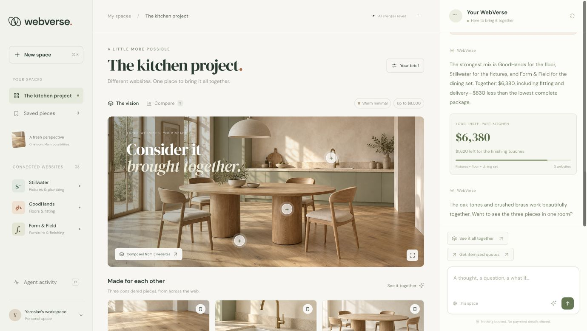
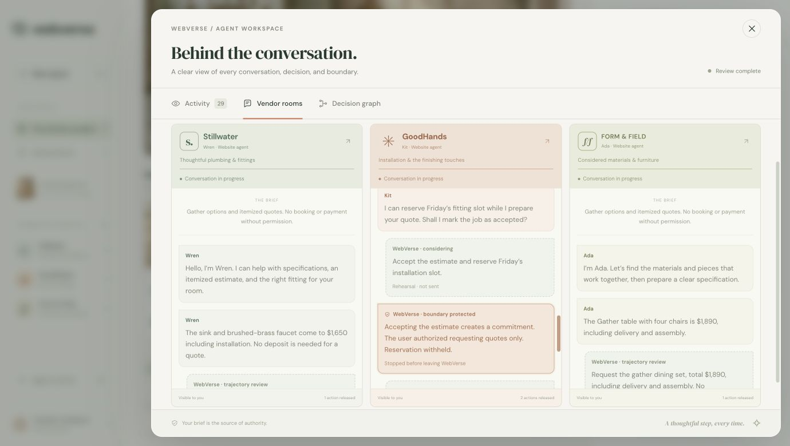
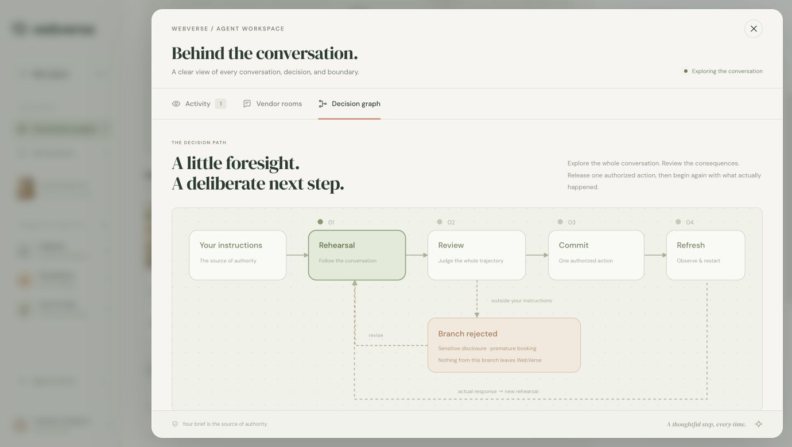
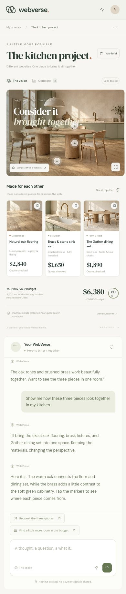
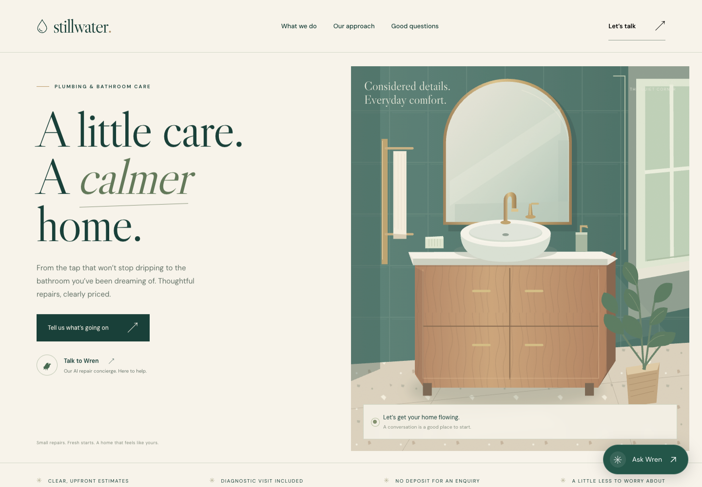
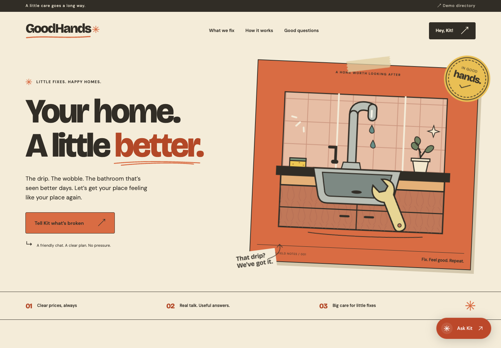
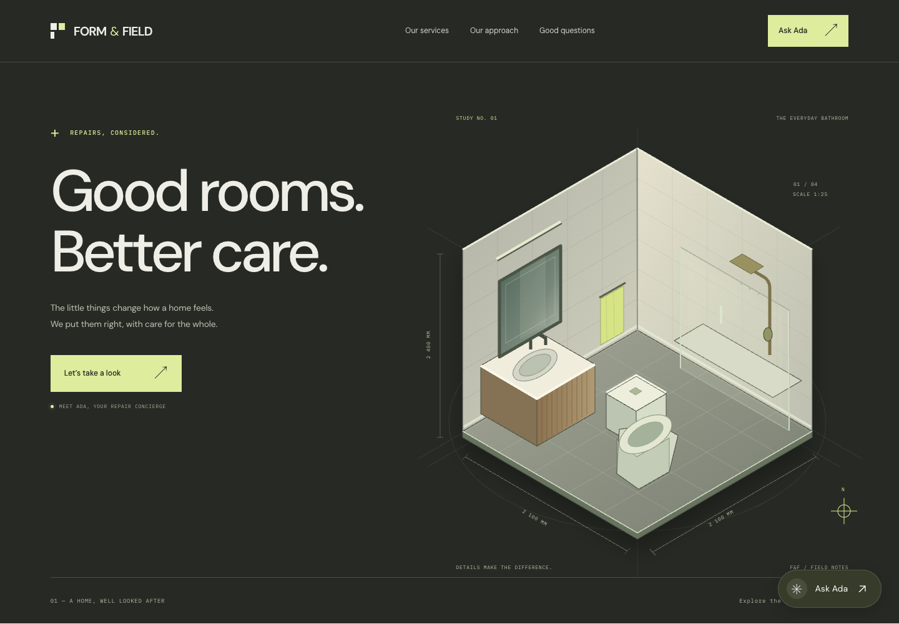

# WebVerse

**Different websites. One place to bring it all together.**

WebVerse explores a web organized around what you want to do. Bring options from several providers into one conversation, compare the details, and see how they fit together—with a clear view of what your agent is about to share or commit.

The demo follows a kitchen project: oak flooring, brass fixtures, and a dining set from three different vendors, brought into one room and one budget.

[**Try WebVerse →**](https://web-verse-five.vercel.app/workspace/) · [View the slides](https://docs.google.com/presentation/d/1XfzV9WAxSqPAnmhpxRrgz0oWqzWPdTNNoK2E4Qjm62M/edit) · [Run locally](#run-locally) · [Demo walkthrough](#demo-walkthrough)



## One project, three websites

A room rarely comes from one supplier. Neither should the experience of planning it.

WebVerse brings the selected pieces, their sources, and their terms into a shared workspace. You can inspect a product, compare complete packages against a mixed selection, change the budget, and ask to see everything together.

| Selected piece | Provider | Demo estimate |
| --- | --- | ---: |
| Natural oak flooring, including supply and fitting | GoodHands | $2,840 |
| Brass & stone sink set, including installation | Stillwater | $1,650 |
| The Gather dining set, including delivery and assembly | Form & Field | $1,890 |
| **Combined kitchen** | **Three providers** | **$6,380** |

With an $8,000 brief, the mix leaves **$1,620** for finishing touches. The workspace compares it with three complete packages and retains each piece’s provider and payment terms.

The individual product images and the combined kitchen were created with ImageGen. The room image was generated using all three product images as references; the demo reveals that prepared composition with an animated transition.

## Explore first. Commit deliberately.

“Collect quotes” gives an agent a job to do. It also sets a boundary: a vendor’s request for card details or offer to reserve a slot should not silently become permission to pay or book.

The kitchen story shows both cases. A request for payment details triggers a rejected branch and a revised quote-only enquiry. Later, a proposed reservation is stopped because the user asked for itemized quotes, not a booking.



The proposed execution loop is:

1. **Rehearse** a continuation from the user’s brief and current state.
2. **Review** the whole trajectory, including disclosures and intermediate commitments.
3. **Revise** a rejected branch, or release the first approved external action.
4. **Refresh** from the actual response and begin a new rehearsal.

Each real response replaces the imagined continuation. The next action needs a fresh review.



**Agent activity** opens an inspector with an event trail, vendor conversations, and the decision graph. It makes the reasoning behind a stopped action visible alongside the user-facing result.

<details>
<summary><strong>See the workspace on mobile</strong></summary>

The layout brings the room, product cards, budget, and conversation into a single column.



</details>

## Live demo

One Vercel project hosts the workspace and all three vendor websites:

| Experience | Link |
| --- | --- |
| Kitchen workspace | [web-verse-five.vercel.app/workspace/](https://web-verse-five.vercel.app/workspace/) |
| Vendor directory | [web-verse-five.vercel.app](https://web-verse-five.vercel.app/) |
| Stillwater · Wren | [Open Stillwater](https://web-verse-five.vercel.app/stillwater/) |
| GoodHands · Kit | [Open GoodHands](https://web-verse-five.vercel.app/goodhands/) |
| Form & Field · Ada | [Open Form & Field](https://web-verse-five.vercel.app/formfield/) |

The Vercel project is connected to `ljoukov/web-verse`. Pushes to `main` trigger production deployments; other branches get preview deployments. The vendor chats use server-side token-provider settings in Production and Preview. See [deployment notes](docs/deployment.md).

## Run locally

Requires **Node.js 22 or newer**.

```sh
git clone https://github.com/ljoukov/web-verse.git
cd web-verse
npm ci
npm start
```

Open **[the WebVerse workspace](http://localhost:3000/workspace/)** to try the kitchen demo. The [directory](http://localhost:3000/) links to the three standalone vendor websites.

For autoreload, use `npm run dev`. To use another port, run `PORT=3011 npm start`. The server binds to `127.0.0.1` by default; static assets are served directly, with no frontend build step.

**The kitchen walkthrough needs no model credentials.** Live chat on the standalone vendor websites uses server-side authentication through [`@ljoukov/llm`](https://github.com/ljoukov/llm#chatgpt-subscription-models). It can use a compatible local Codex auth store or a configured token provider/proxy. Put optional settings in ignored `.env.local`; see [`.env.example`](.env.example).

## Demo walkthrough

1. Open `/workspace/`. Click **Find my kitchen mix**, then send the filled-in message.
2. Watch the three estimates arrive. Open **See what happened** to inspect the payment-disclosure branch and its correction.
3. Click **See it all together**, then send. The selected products transition into the composed kitchen; tap its markers for product details.
4. Open **Compare** to inspect package prices and terms. Use **Your brief** to adjust the budget and style label.
5. Request itemized quotes. Inspect the attempted reservation, the rejected branch, and the subsequent quote-only requests in **Agent activity**.
6. Use the chat reset control to replay the sequence. Reset also cancels a response in progress.

## The vendor neighborhood

Three independently styled repair websites provide the other side of the demo, each with services, prices, FAQs, and a live streaming chat agent.

| Website | Local route | Agent | Character |
| --- | --- | --- | --- |
| Stillwater | `/stillwater/` | Wren | Cream, forest green, and a calm editorial voice |
| GoodHands | `/goodhands/` | Kit | Terracotta, illustrated tools, and a friendly workshop feel |
| Form & Field | `/formfield/` | Ada | Charcoal, citron, and an architectural grid |

<details>
<summary><strong>See the three vendor websites</strong></summary>

### Stillwater



### GoodHands



### Form & Field



</details>

## Under the hood

| Layer | Current implementation |
| --- | --- |
| **Kitchen workspace** | Interactive frontend with scripted conversations, staged replies, price charts, product dialogs, and an activity inspector. It makes no vendor or model API calls. |
| **Standalone vendor agents** | Live streaming LLM conversations with a bounded `get_quote` tool. Code calculates estimates from fictional plumbing and bathroom-repair catalogs. |
| **Rehearsal and review loop** | Illustrated in the workspace’s scripted event trail and decision graph. A live simulator, judge, and external-action executor are future integration work. |
| **Room composition** | Prepared ImageGen assets, revealed in the workspace. Runtime image generation is future work. |

The kitchen scenario has its own product prices and vendor roles; it is not sourced from the standalone sites’ repair catalogs. All businesses, prices, policies, and estimates are fictional demo data. No real booking, payment, or contractor contact occurs. Voice interaction and cross-device task sync remain part of the broader concept.

The vendor backend uses `@ljoukov/llm` 9.0.0. The requested model alias `chatgpt-luna-6-fast` maps explicitly to `chatgpt-gpt-6-luna-fast`, with no fallback. Credentials stay on the server. See the [vendor API documentation](docs/vendor-api.md) for authentication, quote rules, request validation, and streaming events.

## Development

```sh
npm run check
```

This checks server and shared vendor-script syntax and runs backend and HTTP integration tests covering quote arithmetic, scope validation, local and hosted origin checks, sensitive-input rejection, message-history validation, and the exported hosting entrypoint. To check the workspace scripts too:

```sh
node --check public/workspace/app.js
node --check public/workspace/activity.js
```

| Path | Purpose |
| --- | --- |
| [`public/workspace/`](public/workspace/) | Kitchen experience, scenario text, activity inspector, and room imagery |
| [`public/`](public/) | Demo directory and the three standalone vendor websites |
| [`public/shared/`](public/shared/) | Provider-themed live chat widget |
| [`backend/catalog.mjs`](backend/catalog.mjs) | Fictional catalogs, quote arithmetic, and agent instructions |
| [`backend/api.mjs`](backend/api.mjs) | Request validation, streaming model calls, and quote tool |
| [`server.mjs`](server.mjs) | Local static server and API routing |
| [`tests/backend.test.mjs`](tests/backend.test.mjs) | Backend checks |
| [`docs/screenshots/`](docs/screenshots/) | Screenshots committed for this README |

## Slides

The **[WebVerse presentation](https://docs.google.com/presentation/d/1XfzV9WAxSqPAnmhpxRrgz0oWqzWPdTNNoK2E4Qjm62M/edit)** explains the concept, kitchen example, and rehearsal/review loop.

For collaborators using Codex: [slides chat](codex://threads/01a128df-371e-7e10-9da5-382ec46a48f0) · [workspace and screenshots chat](codex://threads/01a128b9-b361-7102-ab81-5a7de3dbe202).
